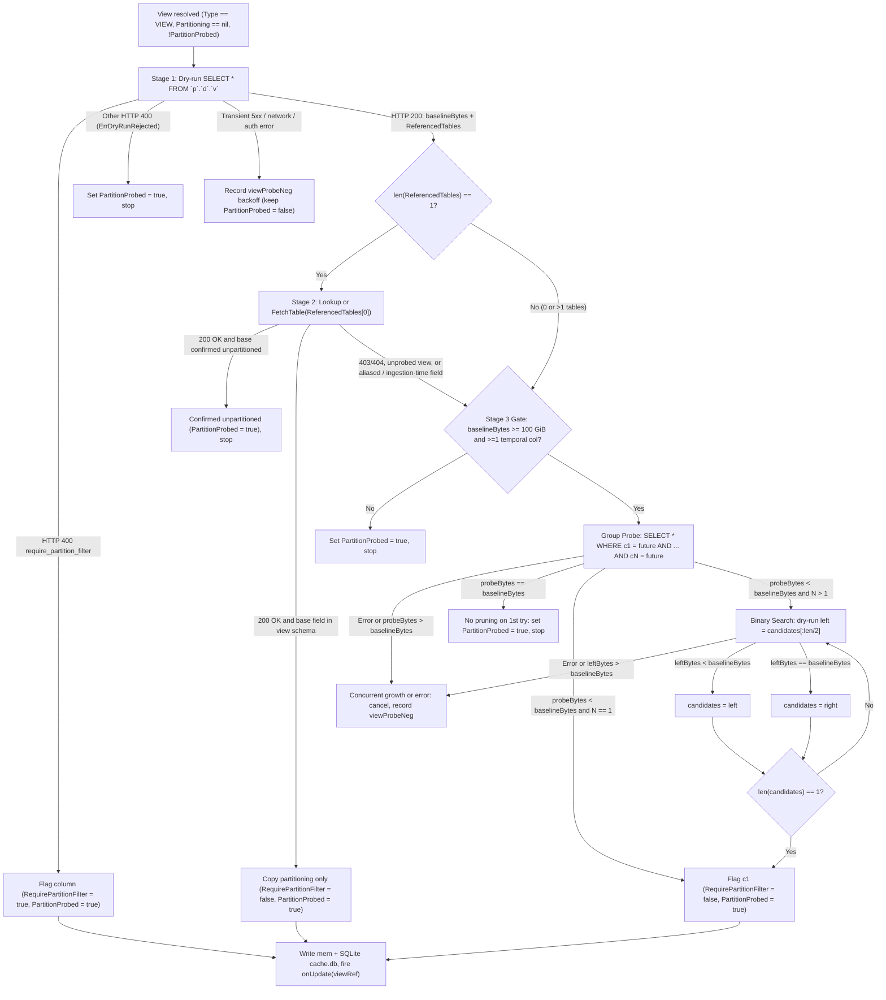

# BigQuery View Partition Discovery

BigQuery's `tables.get` REST v2 endpoint omits `timePartitioning`, `rangePartitioning`, and `requirePartitionFilter` on `VIEW` resources. Because view metadata omits physical layout fields, static catalog fetches cannot detect partition columns or required partition filters on views, including authorized views over restricted datasets.

The `bqpls` language server resolves this gap by combining passive dry-run error inspection with an active three-stage background probe pipeline in `internal/catalog`. Every view probes at most once per SQLite cache TTL, runs strictly sequentially on one dedicated background worker, and propagates discovered partition metadata to LSP diagnostics, semantic tokens, hover cards, and completions.

## Problem Statement

When `bqpls` fetches a physical `TABLE` via `GET /bigquery/v2/projects/{projectId}/datasets/{datasetId}/tables/{tableId}`, BigQuery returns `timePartitioning`, `rangePartitioning`, and `requirePartitionFilter` directly in the JSON payload. When `bqpls` fetches a `VIEW`, BigQuery returns only the view schema and SQL text (`view.query`). Physical partitioning stays hidden in two common cases:

- **Direct views over partitioned tables**: The caller holds read access to the view and its base table, yet `tables.get` on the view omits the base table's partitioning fields.
- **Authorized views over restricted datasets**: The caller can query the view, while `tables.get` on the underlying base table returns HTTP `403 Forbidden` or `404 Not Found`.

Without view partition metadata, the analysis engine cannot emit `require_partition_filter` or `missing_partition_filter` diagnostics on unfiltered view queries, attach the `@lsp.mod.partitioned` semantic token modifier, or mark partition columns with `[PARTITION]` badges in hovers and completions.

## Architecture Overview

Package `internal/catalog` pairs two complementary discovery paths inside `Store`:

1. **Passive dry-run rejection inspection (`internal/catalog/partition_hint.go`, `internal/catalog/dryrun.go`)**:
   - Whenever an interactive cost dry-run (`Store.processDryRun`) fails with HTTP `400` (`ErrDryRunRejected`), `ParseRequiredPartitionFilterError` parses BigQuery's rejection message (`Cannot query over table '...' without a filter over column(s) '...' that can be used for partition elimination`) to extract the rejected table reference and required column list.
   - `applyRequiredPartitionFilterHintLocked` enriches the named table in memory if loaded. When the user query referenced a view rather than the named underlying table, `selectViewPartitionCandidateLocked` maps the concrete partition column back to the queried `VIEW` entry, and `disambiguateViewCandidates` breaks multi-view ties by scanning `ViewDefinition.Query` for the rejected base table reference.
   - If any referenced table or view is still loading on a cold cache (`anyRefPendingLocked`), `Store` buffers the hint in `pendingPartitionHints` (capped at `64` entries with a 5-minute TTL matching `dryRunCacheTTL`). Once `processFetch` loads the missing schema, `applyPendingPartitionHintsLocked` replays the buffered hint, sets `RequirePartitionFilter = true` and `PartitionProbed = true`, writes the updated `TableMeta` to SQLite `cache.db`, and invokes `onUpdate`.
   - Passive inspection reacts only after a failing user query hits `require_partition_filter = true`. It cannot discover optional partition columns (`require_partition_filter = false`) or enrich views before the first failure.

2. **Active three-stage sequential pipeline (`internal/catalog/view_probe.go`, `internal/catalog/store.go`)**:
   - Runs automatically whenever `bigquery_api_enabled = true` (`LSPOptions.BigQueryAPIEnabled`) and `Store.EffectiveBillingProject()` resolves a non-empty billing project (`default_project`, `GOOGLE_CLOUD_PROJECT` / `GCLOUD_PROJECT` / `CLOUDSDK_CORE_PROJECT`, active `gcloud` CLI `[core] project`, or ADC `quota_project_id` / `project_id`). No extra `.bqfmt.toml` or editor flags are required.
   - `enqueueViewProbeIfNeeded` queues a view when `processFetch`, `tryLoadDiskCache`, or a non-static `GetTable` memory hit resolves a `TableTypeView` with `EffectivePartitioning() == nil` and `!meta.PartitionProbed` (driving retries once `viewProbeNeg` backoff expires or after `ClearNegativeCache()`). Static offline schemas loaded from `schema_dirs` or `PutTable` never trigger network probes.
   - A single dedicated worker (`runViewProbeWorker`, reading from `viewProbeCh` and tracked by `Store.ctx` and `Store.wg`) executes all three stages strictly in sequence. Isolating view discovery from the two interactive `dryRunCh` cost workers and two `fetchCh` metadata workers ensures live CodeLens and status-bar dry-runs never wait behind multi-step view probes.
   - `viewProbePending` deduplicates queued or active view keys, while `viewProbeNeg` enforces exponential retry backoff (`30s` base up to `5m` max) after transient errors or mid-probe table growth. The `pruneDryRunMemoryLocked` routine evicts expired `viewProbeNeg` entries, and `Store.ClearNegativeCache()` clears them on demand.



## Stage 1: Unfiltered `SELECT *` Baseline Dry-Run

Stage 1 issues one zero-cost dry-run via `RestClient.DryRunQuery` (`POST /bigquery/v2/projects/{projectId}/jobs` with `configuration.dryRun = true` and `useLegacySql = false`, subject to the 5-second per-request HTTP timeout):

```sql
SELECT * FROM `<project>`.`<dataset>`.`<view>`
```

Helper `quoteBQIdent` escapes both backslash (`\` to `\\`) and backtick (`` ` `` to `` \` ``) characters inside each identifier segment before wrapping it in backticks. Stage 1 classifies the response into four disjoint outcomes:

- **HTTP `400` matching `ParseRequiredPartitionFilterError`**: BigQuery rejects the unfiltered view scan and names the required partition column. When a concrete column from the error matches `viewMeta.Schema`, the worker clones `viewMeta`, sets `TimePartitioning` (or `RangePartitioning` when the matching view column type is `INT64` / `INTEGER`), marks `RequirePartitionFilter = true` and `PartitionProbed = true`, saves the updated metadata to memory and SQLite `cache.db`, fires `onUpdate(viewRef)`, and exits after `1` dry-run. When the rejected column does not exist in `viewMeta.Schema` (such as an unexposed ingestion-time pseudo-column), the worker treats the HTTP `400` as deterministic, marks `PartitionProbed = true`, persists the view, and stops.
- **Other deterministic HTTP `400` (`ErrDryRunRejected`)**: Broken view definitions, deleted downstream tables, or column policy-tag errors will not resolve on immediate retry. The worker marks `PartitionProbed = true`, saves the view entry to memory and `cache.db`, and exits without retrying during the current cache TTL.
- **Transient, auth, or network error**: Any non-`ErrDryRunRejected` failure (HTTP `401`/`403`, `429`, `5xx`, or transport timeout) records backoff in `viewProbeNeg` without setting `PartitionProbed = true`. Future lookups can retry once backoff expires.
- **HTTP `200 OK`**: The worker captures `baselineBytes = res.TotalBytesProcessed` and `res.ReferencedTables`, proving that unfiltered queries succeed (`RequirePartitionFilter = false`), and advances to Stage 2.

## Stage 2: Single Underlying Table Lookup

Stage 2 checks whether `len(res.ReferencedTables) == 1`. If the view references zero tables (constant query) or multiple tables (`JOIN`, `UNION`, or subquery fan-out), the worker skips directly to Stage 3.

For a single referenced table, the worker resolves `baseRef := res.ReferencedTables[0].WithDefaults(defaultProject, defaultDataset)`. It checks the in-memory and SQLite caches first; on a miss, it calls `RestClient.FetchTable` (`tables.get`) directly without triggering nested view probes.

Stage 2 handles three outcomes:

- **Accessible and confirmed unpartitioned (`baseMeta.EffectivePartitioning() == nil` with `baseMeta.Type != TableTypeView || baseMeta.PartitionProbed`)**: A non-view base table or an already-probed nested view confirms the view has no underlying partition key. The worker sets `PartitionProbed = true` on the view, persists the flag to memory and `cache.db`, and terminates immediately, bypassing Stage 3 even when `baselineBytes >= 100 GiB`.
- **Accessible and named partition column exposed (`Field != ""` and `viewMeta.FindColumn(field)` succeeds)**: The worker copies `TimePartitioning` or `RangePartitioning` from `baseMeta` onto the view, forces `RequirePartitionFilter = false` (because Stage 1's unfiltered `SELECT *` already succeeded), sets `PartitionProbed = true`, persists the metadata, fires `onUpdate(viewRef)`, and exits.
  - **Partitioning-only scope**: Stage 2 intentionally omits `baseMeta.Clustering`. View projections, computed expressions, or `WHERE` predicates can break clustering order or alter filter alignment, so copying base clustering fields onto views risks false-positive `clustering_filter` warnings.
- **Fallback to Stage 3**: The worker advances to Stage 3 whenever `tables.get` returns `403 Forbidden` or `404 Not Found` (the standard access pattern for authorized views over restricted datasets), when `len(ReferencedTables) != 1`, when `baseRef` is incomplete or self-referential (`baseRef.NormalizedKey() == viewRef.NormalizedKey()`), when `baseMeta` is an unprobed nested view (`TableTypeView` with `!baseMeta.PartitionProbed`), when the view renames or aliases the base partition column, or when the base table uses ingestion-time partitioning (`Field == ""` for `_PARTITIONTIME` / `_PARTITIONDATE`) that is not directly exposed under a named field in `viewMeta.Schema`.

## Stage 3: Size-Threshold Gate and Group-Testing Binary Search

Stage 3 infers hidden optional partition columns solely from BigQuery dry-run byte counts, without requiring `tables.get` access to any underlying dataset.

### Size-Threshold Gate

Before issuing any filtered probe, Stage 3 enforces a scan-size floor defined by `defaultViewPartitionProbeThresholdBytes = 100 << 30` (`107,374,182,400` bytes, or `100 GiB`; tests can override this threshold with `WithViewProbeThresholdBytes`). If `baselineBytes <= 0 || baselineBytes < threshold`, the worker sets `PartitionProbed = true`, persists the view, and stops after the single Stage 1 dry-run (stopping `0 B` views even when a test sets the threshold to `0`). Small views cost fractions of a cent per full scan and do not warrant additional probe round-trips.

### Capacitor Columnar Storage Invariance (`SELECT *`)

Every Stage 3 probe must use `SELECT *`, matching Stage 1's baseline query. BigQuery stores tables in Capacitor columnar format and accounts for scanned bytes per referenced column:

- `SELECT 1 FROM v` scans `0 B`.
- `SELECT 1 FROM v WHERE non_partition_col = ...` scans `sizeof(non_partition_col) > 0 B`.

Comparing `SELECT 1` queries conflates column projection overhead with partition pruning. Projecting `SELECT *` in both Stage 1 and every Stage 3 probe holds column projection constant across all runs: adding a predicate on non-partition columns leaves `TotalBytesProcessed == baselineBytes`, whereas a sargable predicate on the true partition column prunes entire storage partitions across all columns and forces `probeBytes < baselineBytes`.

### Candidate Column Filtering

The worker scans `viewMeta.Schema` for top-level, non-repeated (`col.EffectiveMode() != ModeRepeated`) columns whose normalized BigQuery type is `DATE`, `DATETIME`, or `TIMESTAMP`, capped at `maxViewProbeColumns = 32`. `ARRAY<DATE>`, `STRUCT` fields, `INT64`, and `STRING` columns are skipped. If zero candidates qualify, the worker marks `PartitionProbed = true`, saves the entry, and stops.

### Probe Predicate Design

For a candidate subset $S = \{c_1, \dots, c_k\}$, Stage 3 constructs one `AND`-joined probe query targeting `<currentUTCYear + 2>-06-15` (for example, `2028-06-15` during UTC year `2026`):

```sql
SELECT * FROM `<project>`.`<dataset>`.`<view>`
WHERE `created_at` = TIMESTAMP '2028-06-15 00:00:00 UTC'
  AND `event_date` = DATE '2028-06-15'
  AND `updated_dt` = DATETIME '2028-06-15 00:00:00'
```

Each column receives a type-exact literal matching its schema type (`DATE 'YYYY-06-15'`, `DATETIME 'YYYY-06-15 00:00:00'`, or `TIMESTAMP 'YYYY-06-15 00:00:00 UTC'`). This choice satisfies four operational invariants:

1. **Outside active time partitions**: A date two years ahead in mid-June falls strictly outside current `HOUR`, `DAY`, `MONTH`, and `YEAR` partitions. Probing `CURRENT_DATE()` or yesterday fails to shrink bytes on `MONTH`- or `YEAR`-partitioned tables where recent data fills the active partition.
2. **Avoids sentinel dates and `__UNPARTITIONED__`**: Warehouse pipelines frequently store placeholder rows at `0001-01-01`, `1900-01-01`, `1970-01-01`, `2099-12-31`, or `9999-12-31`, and BigQuery routes timestamps prior to `1960-01-01` into the legacy `__UNPARTITIONED__` bucket. Mid-year `+2` avoids all of these buckets.
3. **Preserves satisfiability under rolling lower-bound view predicates**: Many analytical views embed lower bounds such as `WHERE dt >= '2024-01-01'` or `WHERE dt >= DATE_SUB(CURRENT_DATE(), INTERVAL 30 DAY)`. Probing a past date contradicts those bounds, causing BigQuery's optimizer to constant-fold the predicate to `FALSE` (`0 B`) even on unpartitioned views and triggering false positives. A future date remains satisfiable against rolling lower bounds.
4. **Sargable under `AND` conjunction**: Exact typed literals avoid implicit casts. Under `AND`, BigQuery's partition pruner applies any conjunct matching the underlying `DATE`, `DATE(col)`, `TIMESTAMP_TRUNC(col, ...)`, or `DATETIME_TRUNC(col, ...)` partition expression independently of other non-partition conjuncts.

### Sequential Halving Algorithm

Given $N$ candidates ($1 \le N \le 32$), Stage 3 runs group-testing binary search:

1. **Initial group probe (`1` dry-run)**: Dry-run all $N$ candidates `AND`-joined together.
   - If the request errors or `probeBytes > baselineBytes`, cancel immediately and record `viewProbeNeg` backoff without setting `PartitionProbed = true`.
   - If `probeBytes == baselineBytes`, no candidate pruned any partition on the first attempt. Set `PartitionProbed = true`, persist, and stop immediately (`2` dry-runs total for unpartitioned `>= 100 GiB` views).
   - If `probeBytes < baselineBytes` and $N == 1$, `candidates[0]` is isolated immediately with no further dry-runs.
2. **Binary halving loop (while `len(candidates) > 1`)**:
   - Split at `mid := len(candidates) / 2` into `left := candidates[:mid]` and `right := candidates[mid:]`.
   - Dry-run `left`.
   - If the request errors or `leftBytes > baselineBytes`, cancel immediately with `viewProbeNeg` backoff without setting `PartitionProbed = true`.
   - If `leftBytes < baselineBytes`, narrow `candidates = left`.
   - Otherwise (`leftBytes == baselineBytes`), narrow `candidates = right`.
3. **Commit**: When `len(candidates) == 1`, record `TimePartitioning{Field: candidates[0].Name, RequirePartitionFilter: false}`, `RequirePartitionFilter = false`, and `PartitionProbed = true`, persist to memory and `cache.db`, and fire `onUpdate(viewRef)`.

### Probe Complexity and Sequential vs. Parallel Design

| Scenario | Stage 1 Dry-Runs | Stage 2 `tables.get` | Stage 3 Dry-Runs | Total Dry-Runs |
| :--- | :--- | :--- | :--- | :--- |
| Stage 1 `require_partition_filter` or HTTP `400` | `1` | `0` | `0` | `1` |
| Stage 2 single base table (partitioned or unpartitioned) | `1` | `0` or `1` | `0` | `1` |
| Stage 3 skipped (`baselineBytes <= 0`, `< 100 GiB`, or `0` temporal cols) | `1` | `0` or `1` | `0` | `1` |
| Stage 3 unpartitioned view (`>= 100 GiB`, $N \ge 1$) | `1` | `0` or `1` | `1` | `2` |
| Stage 3 partitioned view (`>= 100 GiB`, $1 \le N \le 32$) | `1` | `0` or `1` | $1 + \lceil\log_2 N\rceil$ (max `6`) | $2 + \lceil\log_2 N\rceil$ (max `7`) |

We rejected speculative parallel probing in favor of strictly sequential stages and sequential binary halving for three reasons:

- **Strict cross-stage data dependencies**: Stage 2 cannot run until Stage 1 returns `ReferencedTables`, and Stage 3 cannot run until Stage 1 supplies `baselineBytes` and Stage 2 falls through.
- **BigQuery API quota economy**: Probing all $N$ columns concurrently fires up to `32` `jobs.insert` calls for every unpartitioned `>= 100 GiB` view. The sequential initial group test eliminates unpartitioned views in `1` Stage 3 call and isolates a partition column in at most `6` Stage 3 calls (`7` dry-runs total for $N = 32$).
- **Zero interference with interactive LSP responsiveness**: Pinning probes to one dedicated `viewProbeCh` worker caps background probe concurrency at `1` across the workspace, leaving the two `dryRunCh` workers clear for live CodeLens and status-bar estimates.

### Concurrent Table-Mutation Safety

Underlying base tables can receive streaming inserts, `LOAD` batches, or `MERGE` writes between Stage 1 and Stage 3. If any Stage 3 probe returns `probeBytes > baselineBytes`, the baseline is stale and byte-reduction comparisons lose monotonicity. The worker cancels immediately, writes no partition column, leaves `PartitionProbed = false` so `cache.db` is never poisoned with a false negative, and records short retry backoff in `viewProbeNeg`.

One narrow edge case remains accepted by design: if a base table shrinks concurrently (for example, via `TRUNCATE TABLE` or partition expiration) between Stage 1 and Stage 3, a non-partition probe can observe `probeBytes < baselineBytes`. Bounding Stage 3 to views `>= 100 GiB`, executing probes sequentially within milliseconds, and expiring cached metadata at the configured TTL limits exposure without introducing multi-pass re-baselining overhead.

## Caching, Persistence, and LSP Surfacing

### SQLite `cache.db` Persistence

Struct `TableMeta` carries `PartitionProbed bool` (`json:"partitionProbed,omitempty"` on both `TableMeta` and `tableWire`, preserved across `MarshalJSON`, `UnmarshalJSON`, and `Clone`). Each `Store` writes the view's JSON document to `<cache_dir>/cache.db` (SQLite WAL mode).

- **Positive discoveries** (passive hints, Stage 1, Stage 2, and Stage 3) and **confirmed negative outcomes** (Stage 1 deterministic HTTP `400`, Stage 2 unpartitioned base table, Stage 3 `< 100 GiB`, zero temporal candidates, or first-try no-reduction) persist `partitionProbed: true`. Subsequent queries and fresh editor sessions reuse that state without re-probing until the table's effective TTL (`cache_ttl_seconds`, default `86400` / `24h`, or any extended per-project entry in `project_cache_ttl_seconds`) expires.
- **Transient failures and concurrent-growth cancellations** omit `partitionProbed: true` and insert a temporary entry in `viewProbeNeg`.
- **Temporary datasets** whose names start with `_` stay in memory only and never write to `cache.db`.
- **Lock discipline**: Every HTTP dry-run, `tables.get` call, SQLite write, and `onUpdate` callback executes outside `Store.mu`.

### LSP Surface Updates

When passive enrichment or active probing updates a view's partition metadata, `Store` invokes `onUpdate(viewRef)` (`Server.onCatalogUpdate` in `internal/lsp/server.go`). The language server re-analyzes open documents, publishes updated `textDocument/publishDiagnostics`, refreshes CodeLenses, and sends `workspace/semanticTokens/refresh`.

All four editor surfaces update automatically from the same cached `TableMeta`:

- **Diagnostics (`internal/analysis/diagnostics.go`)**: Unfiltered scans against views discovered with `RequirePartitionFilter = true` (Stage 1 or passive dry-run error) emit `require_partition_filter` (configured by `require_partition_filter_severity`). Unfiltered scans against views discovered with `RequirePartitionFilter = false` (Stage 2 or Stage 3) emit `missing_partition_filter` (configured by `missing_partition_filter_severity`).
- **Semantic Tokens (`internal/analysis/types.go`, `internal/analysis/semantic_tokens.go`)**: Partition columns receive the `partitioned` modifier (`ModPartitioned`), mapped to `@lsp.mod.partitioned` (`@lsp.mod.partitioned.bqlang`) in Neovim and `property.partitioned` / `variable.partitioned` in VS Code and Kiro.
- **Hover Cards (`internal/analysis/hover.go`)**: View hover cards display `**Partitioned by:**` (appending `require_partition_filter = true` when required), and column hovers plus schema tables display the `[PARTITION]` attribute badge.
- **Completions (`internal/analysis/completion_scope.go`)**: Discovered partition columns display the `[PARTITION]` tag in `detail` and `labelDetails.description` and sort ahead of clustered and ordinary columns (`0_` sort prefix).
